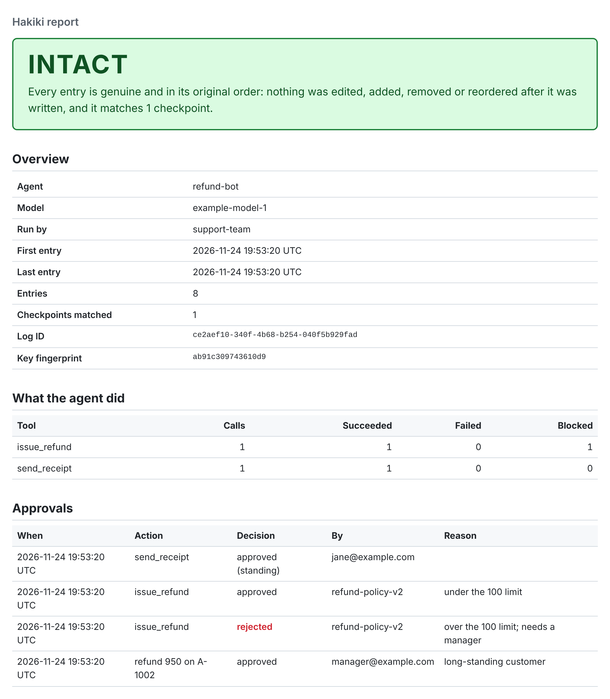

<p align="center">
  <picture>
    <source media="(prefers-color-scheme: dark)" srcset="docs/assets/hakiki-banner-dark.svg">
    <source media="(prefers-color-scheme: light)" srcset="docs/assets/hakiki-banner-light.svg">
    
  </picture>
</p>

<p align="center">
  <a href="https://github.com/ignotia22/hakiki/actions/workflows/ci.yml"></a>
  <a href="pyproject.toml"></a>
  <a href="LICENSE"></a>
  <a href="pyproject.toml"></a>
  <a href=".github/workflows/ci.yml"></a>
</p>

<h3 align="center">Prove what your AI agent did, and who approved it.</h3>

<p align="center">A signed, tamper-evident log of every tool call. Two lines to add. One dependency.</p>

## See it catch tampering

```bash
git clone https://github.com/ignotia22/hakiki && cd hakiki
pip install -e .
python examples/tamper_demo.py
```

The demo records four invoice payments, takes a checkpoint after the third, then attacks the log. Output, with long lines trimmed at `...`:

```text
== 1. The untouched log
INTACT (exit code 0): Every entry is genuine and in its original order: ...

== 2. One entry edited (approver changed to 'nobody')
TAMPERED (exit code 1): This log was changed after it was written: ...
   - entry 1: contents do not match its hash (edited)

== 3. Last entries deleted, checked WITHOUT checkpoints
INTACT: Every entry is genuine and in its original order: ...
   (missed: this is why checkpoints exist)

== 4. Same truncated log, checked WITH the checkpoint
INCOMPLETE (exit code 2): The entries that remain are genuine, but some are missing: ...
   - checkpoint 1 shows the log reached 6 entries, but only 4 remain
```

Case 3 is a miss. Deleting entries from the end leaves a valid chain, so a hash chain on its own cannot see it. Case 4 closes the gap: a checkpoint kept where the operator cannot edit it remembers how long the log was.

## Why Hakiki

| | Ordinary application logs | Hakiki |
|---|---|---|
| Edits detectable | No | Yes. Every entry is hashed, chained to the one before and signed. |
| Deleted entries detectable | No | Yes, with checkpoints stored out of the operator's reach |
| Who approved each action | Only if you build it | Recorded in the same signed log, before the tool runs |
| Stores raw data by default | Usually | No. SHA-256 hashes and a short summary |
| Report a non-engineer can read | No | `hakiki report`, as HTML or Markdown |
| Extra services to run | None for a local file | None. A Python library and a file |
| Checked independently by a third party | No | Yes, with your public key and `hakiki verify` |

**For business owners.** `hakiki report` turns a log into one HTML page you can hand to a client, insurer or auditor. It opens with a single verdict and a sentence explaining it. Below that it lists what the agent did and who approved each action, and it ends with what the report does not prove.

**For agent builders.** Create a `Ledger` and decorate your tools. There is no daemon, proxy or server to run. CI tests every push on Python 3.10 to 3.13 on Linux, macOS and Windows.

**For engineers.** The package is 1,286 lines (`wc -l src/hakiki/*.py`) and depends only on `cryptography`. It uses SHA-256, Ed25519 and canonical JSON. The test suite attacks the log with edits, deletions, reordering, insertions, forged signatures, wrong keys, truncation and tampered checkpoints. One test documents the attack it misses without a checkpoint.

## Quickstart

```bash
pip install git+https://github.com/ignotia22/hakiki
hakiki keygen                      # writes hakiki.key (private) and hakiki.pub (public)
```

Add a ledger to your agent, and a decorator to each tool:

```python
from hakiki import Ledger

ledger = Ledger("run.jsonl", key="hakiki.key", agent="support-bot", model="example-model-1",
                checkpoint_every=50, checkpoint_path="checkpoints.jsonl")

@ledger.tool
def lookup_order(order_id):
    return {"order_id": order_id, "status": "shipped"}

@ledger.tool(approved_by="jane@example.com")
def send_email(to, body):
    ...
```

Anyone with the public key can then check the log and produce a report:

```bash
hakiki verify run.jsonl --pubkey hakiki.pub --checkpoints checkpoints.jsonl
hakiki report run.jsonl --pubkey hakiki.pub --checkpoints checkpoints.jsonl --format html --out report.html
```

`verify` exits with `0` for intact, `1` for tampered, `2` for incomplete and `3` for a usage error, so it slots into scripts and CI. The [`examples/`](examples) folder has runnable versions of everything in this README.

## Works with any model

Hakiki records tool calls, not model internals. The decorator and `ledger.call` wrap plain Python functions, so they work with any model or framework, or with none. `model` is a free-text label stored in every entry and shown in the report.

```python
ledger = Ledger("run.jsonl", key="hakiki.key", agent="triage-bot", model="my-local-model")

def lookup_order(order_id):          # a plain function, no decorator
    return {"order_id": order_id, "status": "shipped"}

ledger.call("lookup_order", lookup_order, {"order_id": "A-1001"})
```

Two helpers take a model's response, record each tool call in it, run the tool through the ledger and return the messages to send back:

```python
from hakiki.integrations import run_openai_tool_calls, run_anthropic_tool_uses

tool_messages = run_openai_tool_calls(ledger, response, {"lookup_order": lookup_order})
tool_results = run_anthropic_tool_uses(ledger, response, {"lookup_order": lookup_order})
```

`run_openai_tool_calls` handles OpenAI Chat Completions and Responses API responses. `run_anthropic_tool_uses` handles Anthropic Messages responses. Both accept SDK objects or plain dicts, and neither SDK is a dependency. Tool errors and rejected approvals are recorded and returned to the model as error results, so the agent loop keeps going.

`run_openai_tool_calls` also accepts the raw JSON body of a chat-completions response. That is the format servers with an OpenAI-compatible API return, Ollama and vLLM among them. [`test_openai_compatible_chat_completions_json`](tests/test_integrations.py) checks a body in that format. The integration tests use fake responses and make no network calls. They check the format and do not run against any provider's service.

## Approvals

Approvals live in the same signed log as the actions they cover. There are three ways to record one:

```python
from hakiki import Approval, ApprovalRejected

@ledger.tool(approved_by="jane@example.com")            # standing approval, recorded on every call
def send_receipt(order_id): ...

def refund_policy(tool_name, args):                     # decided before each call
    if args["amount"] <= 100:
        return Approval("approved", by="refund-policy", reason="under limit")
    return Approval("rejected", by="refund-policy", reason="needs a manager")

@ledger.tool(requires_approval=True, approver=refund_policy)
def issue_refund(order_id, amount): ...

ledger.approve("refund 950 on A-1002", by="manager@example.com")   # recorded by hand
```

With `requires_approval=True`, the tool runs only when the approver returns `Approval("approved", ...)`. A rejection, no answer, any other return value or an approver that raises all count as no. The decision is logged, the tool does not run, and `ApprovalRejected` is raised.

## Privacy

By default the log holds a SHA-256 hash of each set of arguments and each result, plus a summary of type, length and top-level keys. This is the real `data` field written by `lookup_order("A-1001")` in the quickstart:

```json
{"args": {"sha256": "0dd3a2b2afaa5ee2f9c3d72769d7935bc51b2a8986f94cb93097cc93dd915303",
          "summary": {"keys": ["order_id"], "len": 1, "type": "dict"}},
 "tool": "lookup_order"}
```

`A-1001` appears nowhere in the file. A test (`test_default_mode_never_stores_raw_values`) checks that for arguments, results and error messages. To store raw values, opt in. `redact` drops the named keys at any depth before anything is hashed or written, in either mode:

```python
Ledger("run.jsonl", key="hakiki.key", capture="full", redact=["password", "api_key"])
```

## Checkpoints

A checkpoint is a small signed record of how far the log had reached: `log_id`, `seq`, `head_hash`, `count` and `ts`. If the log later turns out shorter, or the entry at that position has changed, `verify` reports INCOMPLETE.

```bash
hakiki checkpoint run.jsonl --key hakiki.key --out checkpoints.jsonl
```

The ledger can also write one every N entries: `Ledger(..., checkpoint_every=50, checkpoint_path="checkpoints.jsonl")`.

A checkpoint only protects you if it is stored where the agent's operator cannot edit it. A checkpoint file on the same machine as the log can be trimmed along with it. Copy each one somewhere else as it is made:

- email it to the client
- commit it to a separate repository the operator cannot rewrite
- copy it to separate storage with versioning or write-once retention

Protection reaches the latest checkpoint held somewhere safe. Entries written after it can still be dropped unnoticed.

## Reports

```bash
hakiki report run.jsonl --pubkey hakiki.pub --checkpoints checkpoints.jsonl --format html --out report.html
hakiki report run.jsonl --pubkey hakiki.pub --format md --out report.md
```

The HTML report is one file with no JavaScript, and it prints cleanly. This is the top of a real report, from running [`examples/approvals.py`](examples/approvals.py) and taking one checkpoint:

<p align="center"></p>

The full report, including the timeline and the section on what it does and does not prove, is in [`examples/sample-report.html`](examples/sample-report.html). Download it and open it in a browser.

## How it works

Each event is one line of JSON. This is the entry behind the privacy example above:

```json
{"actor":"ops","agent":"support-bot","data":{"args":{"sha256":"0dd3a2b2...","summary":{"keys":["order_id"],"len":1,"type":"dict"}},"tool":"lookup_order"},"hash":"b93c4838c7b86a8f...","key_id":"4f9d68b887ebdabd","log_id":"08c57a4d-a538-4a61-8e13-641505ce81aa","model":"example-model-1","prev_hash":"0000000000000000...","seq":0,"sig":"89e9b4a8776c0861...","ts":"2026-11-24T19:54:31.483524Z","type":"tool_call","v":1}
```

- **Types.** `tool_call`, `tool_result`, `tool_error`, `approval`, `note` and `checkpoint`. An `approval` field is added when one applies.
- **Hash.** SHA-256 over the entry's canonical JSON without `hash` and `sig`: `json.dumps(entry, sort_keys=True, separators=(",", ":"), ensure_ascii=False).encode("utf-8")`.
- **Chain.** `prev_hash` is the previous entry's `hash`. The first entry uses 64 zeros.
- **Signature.** `sig` is Ed25519 over the hex `hash`. `key_id` is a 16-character fingerprint of the public key, for display only.
- **Verification.** `verify` checks `seq`, `prev_hash`, `hash` and `sig` for every entry against the public key you pass in. It never trusts a key stored in the log. Checkpoints are signed over their own canonical JSON and checked the same way.
- **Verdict.** TAMPERED if any entry or checkpoint fails. Otherwise INCOMPLETE if the log is empty, or is shorter than or differs from a checkpoint. Otherwise INTACT.
- **Writes.** Appends happen under a lock and are flushed and synced to disk before the call returns. Reopening a log continues its chain.

The core lives in [`ledger.py`](src/hakiki/ledger.py), [`verify.py`](src/hakiki/verify.py), [`checkpoint.py`](src/hakiki/checkpoint.py) and [`entry.py`](src/hakiki/entry.py).

## Limitations

Hakiki shows that a log was not changed after it was written. It does not show that the log is complete or true.

- **No checkpoint, no truncation detection.** Without a checkpoint kept out of the operator's reach, entries deleted from the end go unnoticed.
- **The key holder can rewrite history.** The ledger signs inside the agent's process, so it needs the private key there. Whoever controls that machine can forge new entries, or rewrite the log back to the latest checkpoint they cannot reach. Keep the key out of the agent's working directory, prompts and tools.
- **It only sees what it wraps.** Actions taken outside `@ledger.tool`, `ledger.call` or the integrations are not recorded.
- **Timestamps come from the local clock** and are not independently certified.
- **Hashes are not encryption.** A hash of a guessable value, such as "yes", a small amount or an email address from a known list, can be found by trying candidates. Summaries reveal types, lengths and top-level dictionary keys. Redacted keys are dropped before hashing, so the hash does not cover them.
- **Approvers are not authenticated.** Names, reasons and notes are stored as your code supplies them.
- **One writer process per log file.** Threads are safe. Two processes appending to the same file are not supported.
- **No async tools** in v0.1. Decorating one raises `TypeError`.
- **Values that are not JSON** are captured with `repr()`, so their hashes may not be reproducible elsewhere.
- **A crash mid-write** can leave a partial last line. `verify` then reports TAMPERED, and the ledger refuses to append.

## When Hakiki isn't the right tool

Hakiki is a tamper-evident record and nothing more. If you need to replay agent runs, diff behaviour between versions, enforce policy through a proxy or browse traces in a dashboard, use a fuller observability or governance platform. Hakiki can run alongside it when you also want a signed record that a third party can check.

## Roadmap

- RFC 3161 trusted timestamps for entries and checkpoints
- Adapters for LangChain, CrewAI and MCP
- EU AI Act and ISO 42001 mapping in reports
- A hosted checkpoint service, so checkpoints sit out of the operator's reach by default

## Contributing

See [CONTRIBUTING.md](CONTRIBUTING.md) for how to run the tests and what changes fit.

## Security

Report vulnerabilities privately, as described in [SECURITY.md](SECURITY.md).

## Licence

[Apache License 2.0](LICENSE).

---

<p align="center">Built by David Gitau · <a href="https://hillframe.co.uk">HillFrame</a></p>
